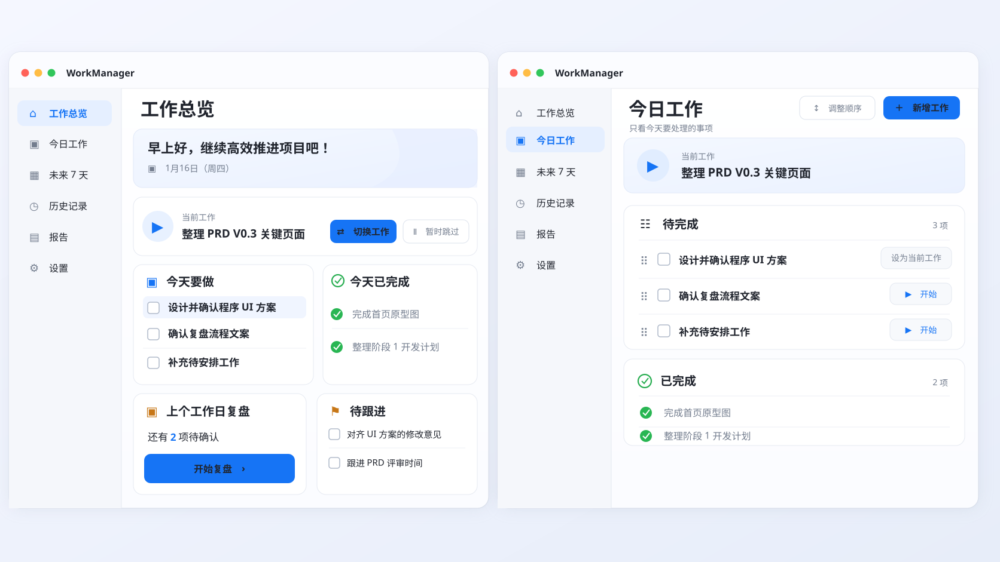

# WorkManager UI 设计规范

**文档版本：** V1.0  
**确认日期：** 2026-11-18  
**状态：** 用户已确认的 UI 原型基线  
**适用技术：** Windows 10 + Tauri 2 + Svelte 5 + TypeScript

> 本规范和原型图是后续 UI 实现、修改和审查的权威依据。AI Agent 不得擅自增加仪表盘指标、图表或装饰模块，也不得在未取得用户确认前改变主页面信息层级。



## 1. 本次确认的设计方向

用户于 2026-11-18 确认以上原型作为 WorkManager UI 基线。设计重点是让用户打开软件后快速看清楚：

1. **今天要做什么。**
2. **今天已经做完什么。**
3. **目前正在处理哪项工作。**
4. **上一个工作日的复盘是否还有待确认内容。**
5. **是否有需要继续跟进的事项。**

整体采用 Apple Human Interface Guidelines 启发的简洁桌面设计：留白、清晰层级、单一蓝色强调色、细分隔线、克制的圆角和轻量动效。它是 Windows 桌面软件，不是 macOS 移植版；实际窗口标题栏和系统控制按钮遵循 Windows 10，不绘制假的 macOS 红黄绿窗口按钮。

原型中的任务标题、日期、数量和状态均为**演示数据**，不是产品默认数据，也不能据此推导业务规则。

## 2. 两个一级核心页面

### 2.1 工作总览

工作总览是打开软件后的默认页面，必须让“今天要做”和“今天已完成”成为第一视觉焦点。

页面只保留以下主要区域：

| 区域 | 展示内容 | 交互 |
|---|---|---|
| 当前工作 | 当前唯一正在处理的工作标题；必要时显示所属项目 | 切换当前工作、暂时跳过 |
| 今天要做 | 今日计划中尚未完成的工作列表 | 点击进入详情；可进入今日工作页 |
| 今天已完成 | 今日已明确完成的工作列表 | 点击查看工作详情 |
| 上个工作日复盘 | 上一个工作日、待确认数量或复盘状态 | 开始/继续复盘 |
| 待跟进 | 被暂时跳过、等待补录进度或用户明确标记跟进的事项 | 打开对应工作 |

布局要求：

- 当前工作在上方单独突出显示。
- “今天要做”和“今天已完成”并列展示，标题必须直观、明确。
- 复盘与待跟进放在次级区域，不得抢占今日工作列表的视觉焦点。
- 没有待跟进事项时隐藏待跟进区域；没有待复盘时显示轻量状态，不显示醒目的空白大卡片。
- 工作标题优先，项目名等辅助信息弱化显示；非必要字段不默认铺满列表。
- 当前工作不应在“今天要做”列表中重复出现。

### 2.2 今日工作

今日工作是第二个核心页面，专门回答“今天具体要处理哪些工作，以及已经完成哪些工作”。

页面只保留：

1. 页面标题“今日工作”。
2. 右上角“调整顺序”和“新增工作”。
3. 顶部独立的当前工作区域。
4. “待完成”列表。
5. “已完成”列表。

列表展示规则：

- 待完成列表按用户保存的今日计划顺序展示。
- 每行默认只展示工作标题和必要的所属项目/状态信息。
- 拖动排序手柄和行内操作应克制；次要操作可在悬停、聚焦或“更多”菜单中显示。
- 非当前工作可以通过明确操作设为当前工作；当前工作切换后，原工作不能被误标记为已完成或已放弃。
- 已完成列表使用完成图标和弱化文字，不再显示“开始”“设为当前工作”等无关操作。
- 当前工作在顶部单独展示，不在待完成列表中重复出现。

## 3. 信息密度与禁止事项

**默认原则：少显示、先显示最重要的内容，需要时再展开。**

工作总览和今日工作页面不得擅自增加以下内容：

- 完成率仪表盘、环形进度图、柱状图或趋势图；
- 专注时长、工时统计、连续打卡、积分或效率评分；
- 大型日历、周计划时间轴或多余的统计卡片；
- 多组重复的任务数量指标；
- 每条任务同时展示优先级、截止时间、估时、标签、备注、附件等全部字段；
- 与 PRD 无关的 AI 助手、云同步、团队协作或账户入口；
- 为了填充页面而显示空卡片、空列表和装饰性图表。

这些信息如属于已确认需求，应放在相应的详情、报表或设置页面，不应堆在工作总览首页。

## 4. 视觉规范

### 4.1 色彩

以浅色主题为首版基线，采用语义化颜色变量：

| Token | 建议值 | 用途 |
|---|---|---|
| `--color-canvas` | `#F5F5F7` | 窗口主背景 |
| `--color-surface` | `#FFFFFF` | 内容面板 |
| `--color-text-primary` | `#1D1D1F` | 标题和主要内容 |
| `--color-text-secondary` | `#6E6E73` | 辅助信息 |
| `--color-divider` | `#E5E5EA` | 细分隔线 |
| `--color-accent` | `#007AFF` | 唯一主要交互强调色 |
| `--color-success` | `#34C759` | 已完成状态 |
| `--color-warning` | `#FF9500` | 待确认/提醒状态 |
| `--color-danger` | `#FF3B30` | 错误或危险操作 |

状态色只表达业务状态，不用于装饰。不要同时使用多套蓝色/紫色作为品牌强调色。

### 4.2 字体

Windows 上优先使用系统字体，不依赖用户机器未必安装的 SF Pro：

`"Segoe UI", "Microsoft YaHei", "DengXian", system-ui, sans-serif`

- 页面标题：约 26–30px，Semibold/Bold。
- 区域标题：约 18–20px，Semibold。
- 工作标题：约 15–17px，Medium/Semibold。
- 辅助信息：约 13–14px，使用次级文字色。
- 保持稳定的字号层级，不通过大量加粗和大字号制造视觉噪声。

### 4.3 间距、形状和动效

- 使用 4px 基础栅格，主要间距采用 8/12/16/24/32px。
- 内容区留白优先，卡片内边距建议 16–20px。
- 卡片圆角建议 12–16px；输入框和按钮圆角统一。
- 以背景层次和 1px 细分隔线区分区域，不使用厚重边框或明显投影。
- 避免全页面毛玻璃和大面积渐变；WebView2 下优先保证清晰度和滚动性能。
- 动效控制在约 120–180ms，尊重系统减少动态效果设置。
- 图标统一使用一种线性图标体系；禁止混用 emoji、实心图标和多套风格。

## 5. 前端代码组织与组件边界

UI 必须采用可维护的分层结构。页面、可复用组件、业务规则和数据访问不能混在同一个 Svelte 文件中。

建议在现有工程基础上渐进形成以下结构（这是目标组织方式，不要求一次性批量创建所有目录）：

```text
src/
├── App.svelte                    # 应用组合入口：壳层和当前页面，不堆业务规则
├── app/
│   ├── AppShell.svelte           # 主窗口布局
│   ├── Sidebar.svelte            # 一级导航
│   └── navigation.ts             # 页面标识与导航定义
├── lib/
│   ├── ui/
│   │   ├── tokens.css            # 唯一设计 Token 来源
│   │   └── components/           # Button、IconButton、TaskRow、Panel 等通用组件
│   ├── features/
│   │   ├── overview/              # 工作总览页面及其专属组件
│   │   ├── today/                 # 今日工作页面及其专属组件
│   │   ├── work-items/            # 工作事项详情/编辑
│   │   ├── daily-review/          # 每日复盘
│   │   ├── reports/               # 日报/周报/月报
│   │   ├── history/               # 历史记录
│   │   └── diagnostics/           # 数据库健康检查等诊断页面
│   ├── bridge/                    # 已有目录：类型安全的 Tauri 命令封装
│   ├── contracts/                 # 已有目录：前后端 DTO/契约
│   └── presentation/              # 已有目录：纯展示格式化函数
└── main.ts
```

### 5.1 职责边界

- `App.svelte`：只负责应用级组合和页面切换，不承载任务列表业务规则、数据库调用或复杂状态机。
- `app/`：负责窗口壳、导航和路由状态。
- `lib/ui/`：只放通用视觉组件和设计 Token，不包含某个业务页面的专属规则。
- `lib/features/<feature>/`：每个业务域独立维护页面、局部组件和页面状态；不要跨 feature 直接引用对方的内部组件。
- `lib/bridge/`：封装 `invoke` 和 Tauri events，统一处理返回类型与错误。
- `lib/contracts/`：维护前后端 DTO；不得在多个页面重复定义相同的数据结构。
- `lib/presentation/`：放纯函数格式化逻辑，不做数据库访问或状态修改。
- Rust Core 是业务规则和数据状态的权威来源；前端不能直接访问 SQLite，也不能自行模拟并持久化业务状态。

### 5.2 状态与组件规则

1. 页面容器负责加载数据、发起命令和管理页面级状态。
2. 通用 UI 子组件通过明确的 typed props 接收数据，通过 callback/事件向上报告用户操作；不在子组件内部直接调用任意 Tauri 命令。
3. 当前工作指针只能有一个权威来源，不能在多个页面分别维护可互相冲突的副本。
4. 工作事项整体状态与每日执行结果必须使用不同字段和不同 UI 语义。
5. 列表使用稳定的业务 ID 作为 keyed each key，禁止使用数组下标作为动态任务列表的 key。
6. 避免为了复用而过度拆分组件；只有具备稳定职责、真实复用或独立测试价值时才抽取组件。
7. 禁止把所有页面和样式继续堆入一个巨型 `App.svelte`。

### 5.3 样式规则

- 所有颜色、字号、间距、圆角和层级从 `tokens.css` 的语义变量读取。
- Svelte 组件使用局部 scoped styles；`app.css` 只负责 reset、字体、基础页面和 Token 引入。
- 禁止用全局选择器修改其他 feature 的内部 DOM。
- 禁止在组件中散落硬编码颜色、重复的间距和重复的按钮样式。
- 修改全局 Token 前必须检查所有页面，避免一个颜色/间距变更导致全局回归。

## 6. Windows 与 Tauri 适配要求

- 视觉语言可以借鉴 Apple，但实际产品是 Windows 10 桌面应用。
- 使用 Windows 原生窗口标题栏和窗口控制按钮；不仿制 macOS traffic lights。
- 不为追求视觉效果引入未经验证的窗口透明、全局 blur 或复杂 WebView2 CSS 特性。
- 最小窗口尺寸和窄窗口布局必须依据实际 Tauri 窗口配置及 Windows 10 实机测试确定，不在原型阶段擅自硬编码。
- 搜索、键盘操作和拖动排序必须提供清晰焦点态和键盘可访问替代方式。

## 7. UI 变更的回归控制

每次 UI 修改都必须控制范围，不能一次性重写多个页面。

### 开发前

1. 阅读本规范、PRD、DECISIONS、技术架构和当前 STATUS。
2. 检查现有页面、组件、状态流和 Tauri bridge，不得假设代码结构与文档完全一致。
3. 先提交组件树/目录调整计划、状态流说明、影响文件清单和测试计划，再开始代码修改。
4. 明确本次修改的页面、组件、接口和不在本次范围内的功能。

### 开发中

- 优先按“一个页面/一个可验证纵向切片”提交。
- 重构公共组件时，先列出所有使用方并逐一回归。
- 不允许为单页样式修改顺手重写全局 Token 或其他页面。
- 不得新增依赖，除非说明必要性、维护状态、许可证、Windows 兼容性和替代方案并获得任务授权。
- 对 loading、empty、error、长标题、长列表、无项目、无当前工作等状态提供明确布局。

### 每次 UI 变更的验证

至少完成：

1. `npm run check`
2. `npm run build`
3. 若修改 Tauri bridge/DTO/Rust Core，运行对应 Rust 检查和测试：`cargo fmt --all -- --check`、`cargo check --workspace --all-targets`、`cargo test --workspace`。
4. 在固定窗口尺寸下分别检查工作总览和今日工作截图；同时检查最小支持窗口尺寸，确认无横向溢出、遮挡、错位和不可点击区域。
5. 回归导航、任务新增、当前工作切换、暂时跳过、排序、完成展示和复盘入口等受影响交互。
6. PR 必须附变更前后截图，并列明验证环境、命令、结果和未覆盖状态。

当前仓库尚未配置独立前端组件测试或视觉回归框架。AI Agent 不得假称这些测试已存在；如需新增测试依赖，先评估并在对应任务中说明。

## 8. GitHub Skill 参考

本设计参考了以下公开 Skill 的设计原则，未复制其源代码、图片或组件实现：

- [macos-design-skill](https://github.com/ceorkm/macos-design-skill)：借鉴桌面应用内容优先布局、简洁侧边栏、渐进式披露、快捷操作和系统原生集成思路；该 Skill 标注 MIT 许可证。
- [claude-apple-design-system](https://github.com/rukkiecodes/claude-apple-design-system)：借鉴单一强调色、语义化 Design Tokens、细分隔线、克制层级和一致组件规范；该 Skill 标注 MIT 许可证。

参考 Skill 只作为设计方法，不构成对其代码、素材或依赖的引入。WorkManager 仍按 DEC-026 完全自研。

## 9. AI Agent 实施指令

当用户授权开始相应业务任务后，AI Agent 必须：

1. 将本规范和原型图视为 UI 实现的验收基线，不自行重新设计主页面。
2. 先审查现有代码并给出文件/组件拆分方案，再实施。
3. 先建立 Token 和稳定的应用壳，再分别实现工作总览、今日工作；不要一次性把所有功能页面全部铺开。
4. 保持业务状态由 Rust Core 管理，UI 只通过类型安全 bridge 调用。
5. 每个纵向切片都要附截图、测试结果和影响范围说明。
6. 如发现 PRD 与原型冲突，暂停相关实现并报告，不得自行选择更方便的方案。

**授权边界：** 本次确认完成的是 UI 设计和文档基线，不代表 T1-02 或其他业务代码任务已自动启动。当前开发计划中 T1-02 仍须等待用户单独启动指示；不得把本次文档提交解释为业务开发授权。
