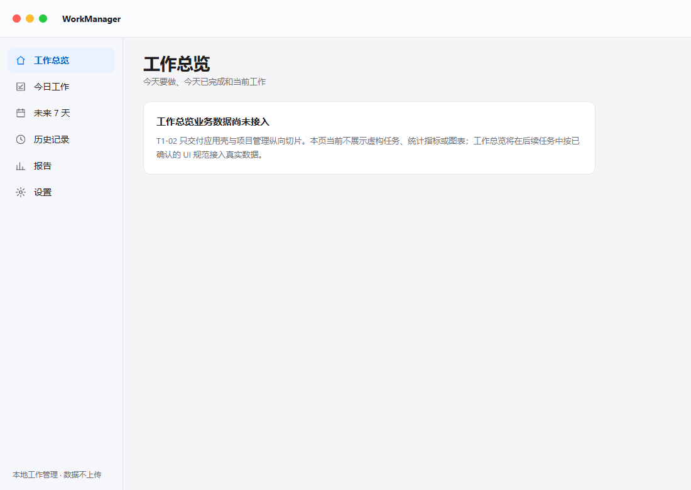
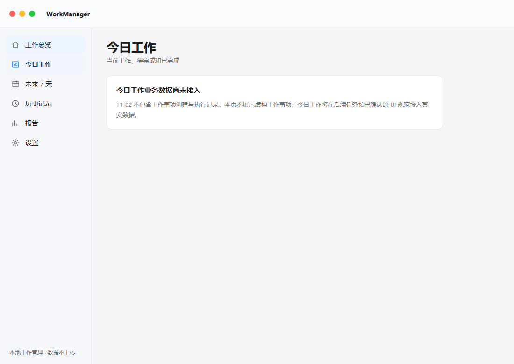
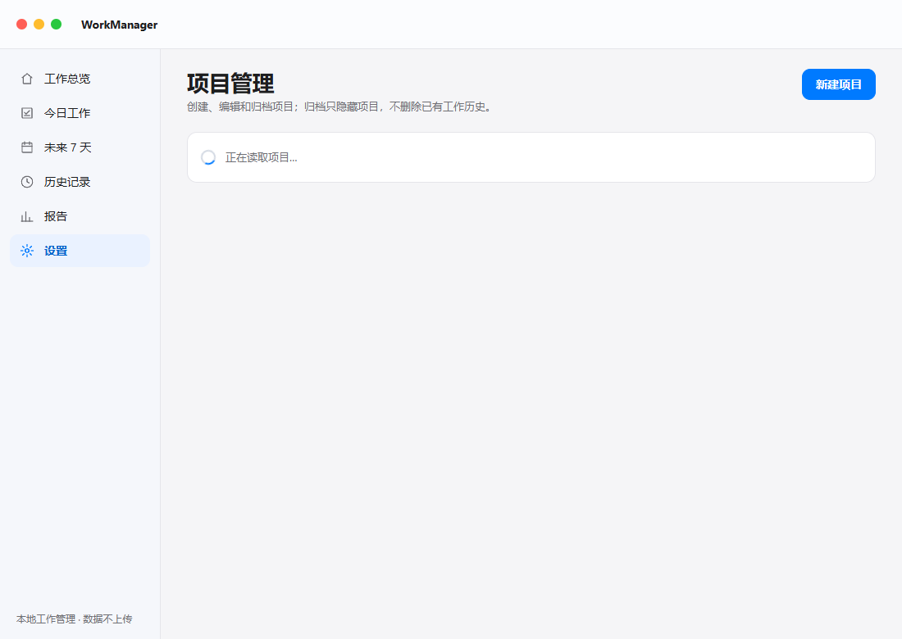
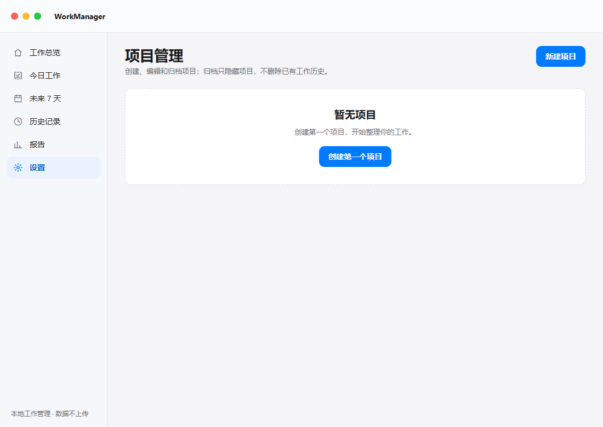
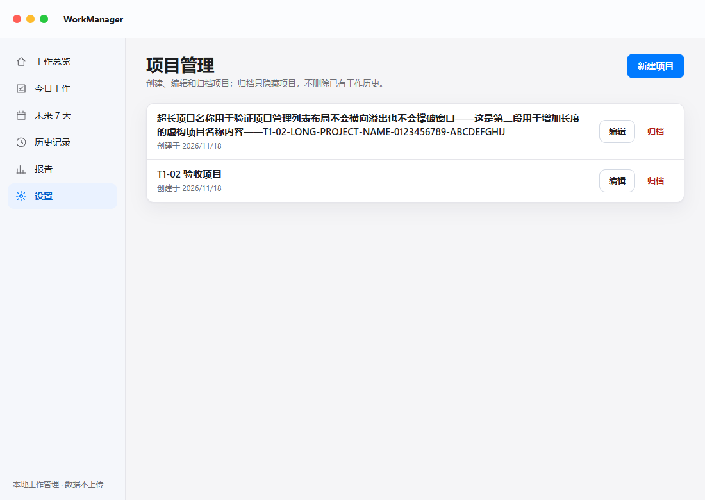
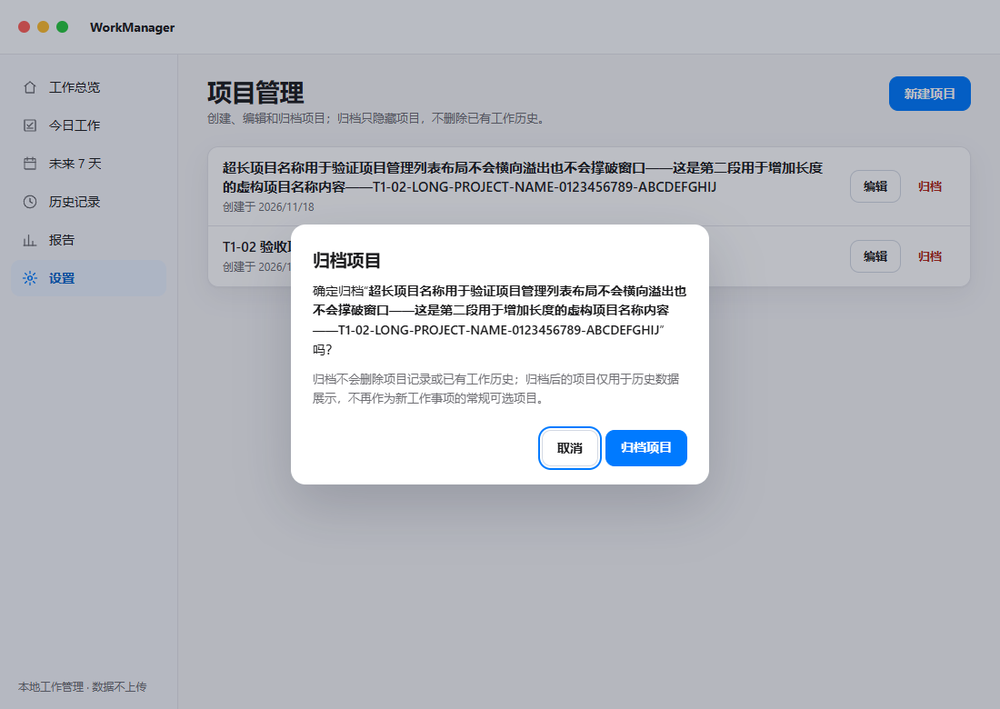
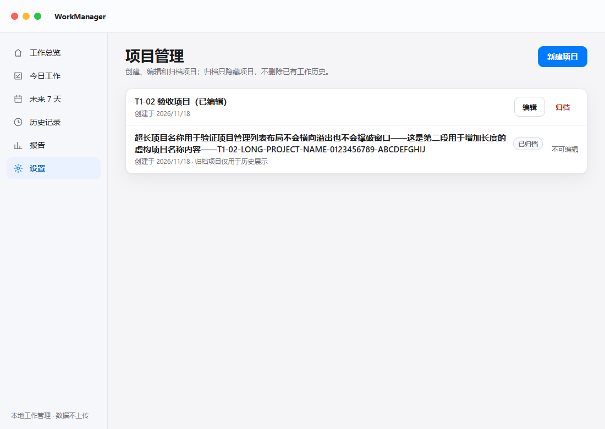
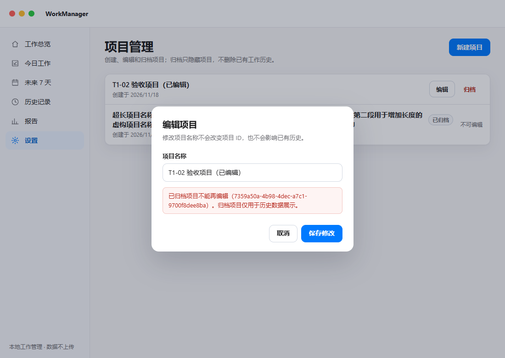
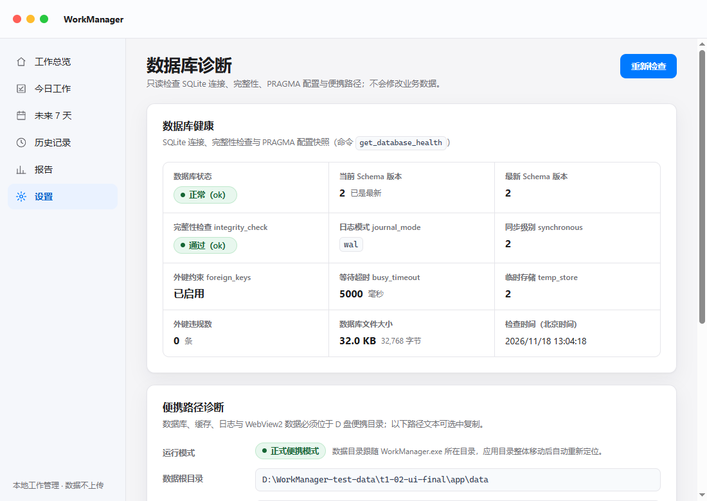
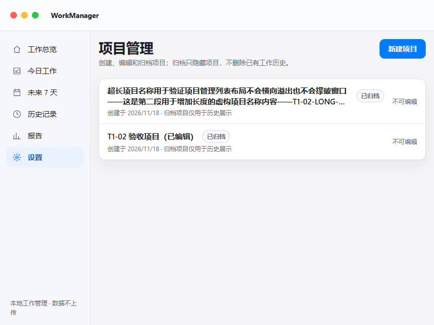

# T1-02 测试与交付报告：项目创建、编辑、归档

**任务 ID：** T1-02  
**任务名称：** 项目创建、编辑、归档  
**所属阶段：** 阶段 1：基础架构与工作事项  
**任务状态：** **待审计**（开发代理自测完成，未经独立审计，不得视为验收完成）  
**报告日期：** 2026-11-18  
**开发分支：** `task/T1-02-project-management`  
**目标分支：** `main`  
**基线 main：** `0cafde61078c8d428a37cd509a349e4db8f4096e`  
**代码提交：** `b8962b5`（Core + migration）、`2b3035d`（Tauri IPC）、`14a542e`（UI）、`30666c8`（验证脚本）  
**机器可读证据：** [T1-02-evidence.json](T1-02-evidence.json)

> 本报告记录开发代理的实际实现与自测结果。独立审计尚未进行，任务状态只能为“待审计”。

---

## 1. 实际实现范围

本任务交付“项目管理”纵向切片：

- SQLite migration 0002：新增 `projects` 表；
- Rust Core 项目领域模块：模型、校验、仓储、服务、事务边界；
- Tauri typed IPC：`list_projects`、`create_project`、`update_project`、`archive_project`；
- 前端 typed Bridge / DTO Contracts / 运行时契约校验；
- Design Tokens、AppShell、Sidebar、navigation 基础结构；
- 项目管理页面：列表、创建、编辑、归档、loading / empty / error 状态、长名称裁剪与完整名称提示；
- 数据库诊断页从旧 `App.svelte` 迁移到 `lib/features/diagnostics`，功能与数据保持不变；
- 工作总览 / 今日工作结构回归页（明确标注业务数据尚未接入，不展示虚构数据）；
- Release UI/IPC 自动化证据脚本与继承回归脚本适配（schema v2）。

**未实现（严格遵守任务边界）：** T1-03 工作事项创建、T1-04 多项目独立副本、T1-05 状态流转、每日计划、复盘、报表、附件、备份恢复、TOCTOU 安全加固。

另：本分支保留并整合了会话开始前工作区中未提交的 DEC-032 自定义标题栏变更（`e6da283`、`a9e73f1`、`8605cc2`），并完成真实窗口行为验证。该内容属于已确认的 UI Shell 前置切片。

## 2. 数据库 schema 与 migration

- 新增 `crates/workmanager-core/migrations/0002_projects.sql`，schema version 从 **1 → 2**。
- `projects` 字段严格限定为 PRD / 技术设计定义：`id`、`name`、`is_archived`、`created_at`、`updated_at`。
- 约束：`id` 主键；`name` 非空（`CHECK length(trim(name)) > 0`）；`is_archived` 只能为 0/1；`STRICT` 表。
- 索引：`(is_archived, created_at DESC, id DESC)`，用于“未归档在前、归档在后”的确定性列表顺序。
- 未擅自增加项目字段；未建立名称唯一约束（PRD 未定义）。
- migration 沿用 T1-01 的 `PRAGMA user_version` + `schema_migrations` 机制；每个 migration 独立 `IMMEDIATE` 事务，失败回滚。
- 不修改 T1-01 已确认的 0001 migration 历史。

### 2.1 已验证的 migration 行为

| 行为 | 结果 |
|---|---|
| 全新数据库执行 0001 + 0002 | PASS：schema=2，integrity=ok，foreign_key_check=0 |
| T1-01 schema 1 数据库升级到 2 | PASS：旧 `settings` canary 保留，可继续创建项目 |
| migration 失败回滚 | PASS：失败版本不前进 `user_version`，已提交版本保留 |
| 升级/写入后完整性 | PASS：`PRAGMA integrity_check=ok`，`foreign_key_check=0` |
| 新版数据库被旧代码误读 | 沿用 T1-01 的 `schema-version-too-new` fail-closed 行为，未修改 |

## 3. Rust Core（`crates/workmanager-core`）

新增 `projects/` 模块：

```text
crates/workmanager-core/src/projects/
├── mod.rs
├── model.rs       # Project、名称规范化/校验
├── error.rs       # 稳定错误码
├── repository.rs  # 参数化 SQL
└── service.rs     # 业务规则、写事务边界
```

关键设计：

- `ProjectService`（Core）是项目状态的唯一权威来源；Tauri 层不实现项目规则。
- 新增 `Database::write_transaction`：`IMMEDIATE` 事务、成功提交、失败显式回滚；项目写操作全部经由此边界。
- 项目 ID 由 Core 生成本地 UUID v4 字符串并持久化，前端不得用数组下标作为身份。
- 项目名称只做 PRD 支持的最小必要校验：`trim` 后非空；不限制长度（长名称是 UI 边界场景）；不做唯一性约束。
- 列表顺序：未归档在前、归档在后；同组按 `created_at DESC, id DESC`，保证确定性。
- 归档是 `UPDATE is_archived = 1`，非删除；重复归档幂等且不刷新归档时间。
- 已归档项目拒绝编辑（`project-archived`），保留在列表用于历史展示；不实现取消归档（PRD 未定义）。
- 错误结构：`project-name-empty`、`project-not-found`、`project-archived`；数据库错误透传 T1-01 稳定错误码。

## 4. Tauri IPC

`src-tauri/src/commands/projects.rs` 新增 4 个 `async` 命令，业务执行在 `spawn_blocking` 阻塞线程池：

| 命令 | 请求 | 响应 |
|---|---|---|
| `list_projects` | 无 | `Project[]`（camelCase） |
| `create_project` | `{ input: { name } }` | `Project` |
| `update_project` | `{ input: { id, name } }` | `Project` |
| `archive_project` | `{ input: { id } }` | `Project` |

- 请求 DTO 使用 `deny_unknown_fields`，拒绝契约漂移。
- 错误统一为 `{ code, message }`，不返回 SQL、内部路径或用户工作内容。
- 未提供 `execute_sql` / `query_sql` / 任意文件读写接口；Release 证据中已验证调用 `execute_sql` 被拒绝（`Command execute_sql not found`）。
- SQLite 连接仍封装在 `AppState` 的 `Mutex<Option<Database>>` 内，不进入前端。

## 5. 前端 UI

### 5.1 目录结构（按 UI-DESIGN-SPEC 渐进形成）

```text
src/
├── App.svelte                       # 仅应用组合与页面切换
├── app/
│   ├── AppShell.svelte
│   ├── Sidebar.svelte
│   └── navigation.ts
└── lib/
    ├── ui/tokens.css
    ├── ui/components/{Button,PageHeader,EmptyState}.svelte
    ├── features/overview|today|settings|projects|diagnostics|placeholder/
    ├── bridge/{databaseHealth,projects}.ts
    ├── contracts/{ipc,databaseHealth,projects}.ts
    └── presentation/{healthFormat,projectFormat}.ts
```

标题栏组件保留在 `src/lib/WindowTitlebar.svelte`（DEC-032 已有实现），由 AppShell 统一组合。

### 5.2 项目管理页面

- 入口：设置 → 项目管理（不新增截图未包含的一级导航项）。
- 列表：项目名称（长名称最多 2 行，`title` 属性可查看完整名称）、创建日期、归档标记、编辑/归档操作；归档项目不再显示编辑/归档按钮。
- 新建/编辑：原生 `<dialog>` 模态，校验空名称，提交中禁用并显示 loading。
- 归档：最小确认弹窗，明确说明“不删除项目记录或已有工作历史”；归档后通过 Rust Core 重新拉取列表，前端不自行推导权威状态。
- 状态：loading（轻量行内 spinner）、empty（“暂无项目 / 创建第一个项目”）、error（错误码 + 消息 + 重新加载）、写操作失败在弹窗内以 `role="alert"` 展示。
- 数据全部来自真实 Tauri IPC → Rust Core → SQLite；无静态演示数据、无 localStorage/IndexedDB 业务状态。

### 5.3 工作总览 / 今日工作 / 诊断页

- 工作总览与今日工作建立了 AppShell 内的结构页，明确标注“业务数据尚未接入”，不展示虚构任务或统计指标。
- 数据库诊断页迁移后保留 T1-01 全部功能：健康指标、便携路径、migration 记录、错误/加载状态；Release 回归 24/24 通过。

## 6. 测试环境

| 项目 | 值 |
|---|---|
| 操作系统 | Windows 10 19045（DESKTOP-U5GCI7T） |
| Rust | rustc 1.100.0 / cargo 1.100.0 |
| Node / npm | v22.20.0 / 10.9.3 |
| PowerShell | Windows PowerShell 5.1.19041.6456 |
| 测试数据目录 | `D:\WorkManager-test-data`（隔离；正式目录 `D:\WorkManager` 未触碰） |
| Release | `target\release\workmanager.exe`，10,230,272 字节，SHA-256 `DF4469EA067DEE39E10E49F0592FD4A9DAB076F4186FF3E8CF60F8F72EABB7E8` |

## 7. 回归测试命令与结果

| 命令 | 退出码 | 结果 | 证据 |
|---|---:|---|---|
| `cargo fmt --all -- --check` | 0 | PASS（无输出） | [日志](T1-02-assets/logs/cargo-fmt-check.log.txt) |
| `cargo check --workspace --all-targets` | 0 | PASS，无 warning | [日志](T1-02-assets/logs/cargo-check.log.txt) |
| `cargo test --workspace` | 0 | **90 passed / 0 failed** | [日志](T1-02-assets/logs/cargo-test-workspace.log.txt) |
| `npm run check` | 0 | svelte-check 0 errors / 0 warnings | [日志](T1-02-assets/logs/npm-check.log.txt) |
| `npm run build` | 0 | Vite 构建成功 | [日志](T1-02-assets/logs/npm-build.log.txt) |
| `npm run tauri build -- --no-bundle` | 0 | Release 构建成功 | [日志](T1-02-assets/logs/tauri-build.log.txt) |
| `verify-t1-02-ui.ps1` | 0 | 真实 Release UI/IPC **73/73 + 11/11**，关闭按钮真实退出 | [日志](T1-02-assets/logs/verify-t1-02-ui.log.txt) |
| `verify-release-portable.ps1` | 0 | TOTAL=106 PASS=90 **FAIL=0** WARN=1 INFO=15 | [日志](T1-02-assets/logs/verify-release-portable.log.txt) |
| `verify-release-faults.ps1` | 0 | TOTAL=73 PASS=64 **FAIL=0** WARN=0 INFO=9 | [日志](T1-02-assets/logs/verify-release-faults.log.txt) |
| `inspect-release-ui.mjs`（诊断页） | 0 | 24/24 断言，CSP 0 违规 | [日志](T1-02-assets/logs/inspect-release-ui.log.txt) |

### 7.1 项目领域新增/关键自动化测试（15 项，全部 PASS）

1. 创建项目并返回稳定 UUID、trim 名称、可查询列表；
2. 重启后项目数据保持；
3. 编辑名称保持项目 ID 与创建时间、更新时间前进；
4. 归档不删除记录且列表仍可见；
5. 重复归档幂等且不刷新归档时间；
6. 归档不删除已有历史关联（测试探针表 + 外键检查）；
7. 多项目编辑/归档互不污染；
8. 空白名称拒绝且不写行；
9. 未知项目 ID 编辑/归档返回 `project-not-found`；
10. 已归档项目拒绝编辑（`project-archived`）；
11. 注入 UPDATE 失败触发器后写事务完整回滚（名称、更新时间不变）；
12. 新数据库运行全部 migration 并通过完整性与外键检查；
13. schema 1 → 2 升级保留 T1-01 canary 且可继续写项目；
14. 追加失败 migration 回滚且不影响既有项目数据；
15. 项目操作后与重启后 integrity/foreign_key_check 保持 `ok`。

另有：项目名称模型单测 4 项、Tauri 适配层 DTO/项目上下文测试 3 项；T1-01 原有测试全部保留并按 schema v2 更新期望，未删除、未降低标准。

## 8. Release UI/IPC 证据

脚本 `scripts/verify/verify-t1-02-ui.ps1` 编排真实 Release + WebView2 + CDP：

- 主检查 **73/73 PASS**：应用壳、6 项一级导航、三色窗口按钮、默认工作总览、今日工作、设置、loading、空状态、真实 UI 创建/编辑/归档、长名称、归档后操作消失、真实错误态、归档记录仍存在、诊断页、CSP 0 违规、页面 0 未捕获异常、最大化/还原真实窗口 API。
- 最小窗口检查 **11/11 PASS**：按外部 Win32 调整为 860×640（实际视口 844×632），工作总览与项目管理无横向溢出，新建弹窗完整可见；点击红色关闭圆点后进程**真实退出（退出码 0）**。
- loading 状态通过 CDP CPU 限速放慢渲染线程后稳定观察并截图；真实异步 IPC 未被 mock。
- `isArchived` / 时间字段等 DTO 契约由直接 IPC 调用核对，创建/编辑/归档结果均回读自 SQLite。

机器可读证据：[t1-02-ui-evidence.json](T1-02-assets/t1-02-ui-evidence.json)、[t1-02-min-window-evidence.json](T1-02-assets/t1-02-min-window-evidence.json)、[t1-02-ui-orchestration.json](T1-02-assets/t1-02-ui-orchestration.json)。

### 8.1 截图（真实 Release 运行）

| 工作总览（正常窗口） | 今日工作（正常窗口） |
|---|---|
|  |  |

| 项目管理 loading | 项目管理空状态 |
|---|---|
|  |  |

| 多项目 + 长名称 | 归档确认 |
|---|---|
|  |  |

| 归档后（无编辑/归档操作） | 真实错误状态 |
|---|---|
|  |  |

| 数据库诊断（T1-01 功能未破坏） | 最小窗口 844×632 |
|---|---|
|  |  |

最小窗口：工作总览见 [overview-min.png](T1-02-assets/screenshots/overview-min.png)，最小窗口新建弹窗见 [projects-dialog-min.png](T1-02-assets/screenshots/projects-dialog-min.png)。

## 9. 继承 Release 脚本回归

- `verify-release-portable.ps1`：**106 项，90 PASS / 0 FAIL / 1 WARN / 15 INFO**。唯一 WARN 仍是本机既有的 `%LOCALAPPDATA%\EBWebView` 历史目录（非本次创建，前后时间戳未变）。schema 期望已更新为 v2，`projects` 表存在、migration 记录为 1、2。
- `verify-release-faults.ps1`：**73 项，64 PASS / 0 FAIL / 0 WARN / 9 INFO**。覆盖损坏库、0 字节库、data 被文件阻塞、work.db 为目录、ACL 拒绝写入；启动失败对话框、非零退出码、原文件字节不变均通过。
- 旧 T1-01 诊断页 UI 检查已适配新应用壳并可重复运行：24/24 通过。

## 10. 业务规则取舍与假设（供审计重点核对）

PRD / 技术设计未定义、但实现必须选择的边界，均按最小必要原则处理，未擅自扩展业务：

| 事项 | 实现 | 依据/说明 |
|---|---|---|
| 项目名称规则 | trim 后非空；无最长限制、无唯一约束 | PRD 只说“用户可以创建、编辑和归档项目”；未定义唯一性/长度 |
| 归档后编辑 | 拒绝（`project-archived`） | 任务要求归档项目“仍可用于历史数据展示”；未定义归档后编辑 |
| 归档幂等 | 重复归档返回当前记录且不刷新时间 | 避免双击/重复请求产生无意义写入 |
| 取消归档 | 未实现 | PRD 只定义创建/编辑/归档，未定义恢复 |
| 项目列表顺序 | 未归档在前；同组 created_at DESC, id DESC | UI 需区分归档项目；确定性避免列表跳动 |
| 项目 ID | Core 生成 UUID v4 | 技术设计列出 uuid 为主键候选，任务要求稳定 ID |
| 历史关联测试 | 测试专用探针表模拟未来 work_items 外键 | T1-02 不创建 work_items（T1-03）；证明归档不触发级联删除 |
| 新增依赖 | `uuid`（MIT/Apache-2.0）、`serde_json`（仅测试，MIT/Apache-2.0） | 均为技术设计候选/Cargo.lock 既有 crate；无新增运行时服务或遥测 |

## 11. 未覆盖与遗留风险

1. **未做独立审计**：本报告仅为开发代理自测，状态“待审计”。
2. 仓库仍无前端组件测试/视觉回归框架；UI 回归依赖真实 Release CDP 脚本与人工截图复核。
3. 项目名称唯一性、删除/恢复、项目排序偏好等 PRD 未定义行为未实现；如产品需要，应由后续任务确认。
4. `archive_does_not_delete_existing_history_associations` 使用测试探针表，不代表 T1-03 已完成；真实工作事项关联必须由 T1-03 建立并由后续任务验证。
5. TOCTOU 残余风险按 DEC-029 接受并延期至 [Issue #2](https://github.com/shuaikun853-dev/work-kanban/issues/2)，本任务未修复；不得宣称绝不会写入 C 盘。
6. 普通 SQLite 文件未加密；拥有文件访问权限的人可读取数据库内容。
7. 自动备份、备份轮转与恢复策略仍未确认（OPEN-001/002/003），本任务未实现、未宣称备份。
8. 窗口标题栏为 DEC-032 自定义无边框实现；已通过真实窗口 API（最大化 1100→1920→1100、关闭按钮真实退出）验证，但未做长时间拖动/多显示器/高 DPI 专项矩阵。
9. 未新增真实工作事项、每日计划、复盘、报表、附件等未授权功能；T1-03 未开始。

## 12. 结论

- T1-02 代码、migration、Rust Core、typed IPC、项目 UI、自动化测试、Release 实跑与证据均已提交本分支。
- 所有要求的本地回归命令退出码为 0；Rust 90/90 测试通过；Release UI/IPC 73/73 与最小窗口 11/11 通过；继承 Release 脚本 0 FAIL。
- **当前状态：待审计。** 开发代理不自行标记“验收完成”；等待独立审计与用户验收。
- **T1-03 未开始。**
